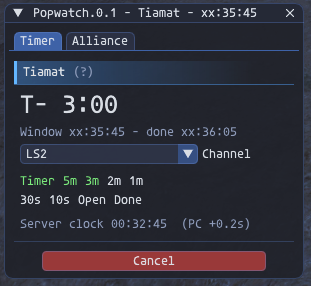

# Popwatch

**An FFXI addon for HorizonXI (Ashita v4) that counts down to a spawn window and announces
it to your party or linkshell.**

Enter the window time from your ToD tracker and Popwatch posts a countdown at fixed
checkpoints, so everyone sees the same warnings at the same second. It also lists your
alliance, ready for a DKP screenshot or a paste into Discord.



---

## Features

- **Server-synced countdown.** Timing runs on the game server's clock, not your PC clock,
  so every announcer hits each checkpoint at the same second
- **Fixed checkpoints.** 10 min (when started early enough), 5, 3, 2 and 1 min, 30 and 10 sec,
  window open, and 20 sec after
- **Single or 7-window timers.** 7-window timers run windows 10 minutes apart, and you can
  start from any window
- **Timezone-friendly messages.** The hour is shown as `xx`, so players in other timezones
  read the minutes and seconds directly
- **Announce or stay silent.** Post to Party, LS1 or LS2, or Echo the messages only to yourself
- **Alliance roster.** Party-by-party member list with one-click copy as a Discord code block

## Installation

1. Extract the `Popwatch` folder into `Ashita4/addons/`
2. `/addon load popwatch`

## Setting a timer

Open the window with `/pw`, fill in the **Timer** tab and press **Start**.

| Field | What to enter |
|---|---|
| Name | The mob, e.g. `Fafnir`. ASCII only, up to 30 characters, no `<` or `>` |
| Time | `HH:MM:SS` in your local 24-hour time, or `MM:SS` for the next time the clock shows it. A `HH:MM:SS` already passed today means tomorrow |
| Windows | `1`, or `7` for windows 10 minutes apart |
| Current window | Shown for 7 windows: the window the time you entered belongs to |
| Channel | Echo, Party, LS1 or LS2. Can be changed while a timer runs |

Messages look like this:

```
--- Fafnir --- Timer: xx:42:15 (~12 min)
--- Fafnir --- 10 min (xx:42:15)
--- Fafnir --- 5 min (xx:42:15)
...
--- Fafnir --- 10 sec (xx:42:15)
--- Fafnir --- NOW / Window Open (xx:42:15)
--- Fafnir --- Window Done (xx:42:35)
```

On a 7-window timer, the message 20 sec after each window announces the next one, e.g.
`Next Window [3/7] (xx:52:15)`, and the timer moves on to that window.

Checkpoints already passed when you start are skipped. A checkpoint that falls while you
are zoning is sent on arrival if it is at most 5 seconds late, otherwise dropped. The
running view colours each checkpoint: green sent, white pending, grey skipped, red dropped.

If several people run Popwatch for the same window, all but one should set their channel to
**Echo** to avoid duplicate posts.

## Alliance tab

Lists every party in the alliance in in-game order, under the current or most recent timer.

- **Copy for Discord** copies the list as a code block:

  ````
  ```
  Popwatch - Fafnir - xx:42:15
  P1: Name1, Name2, Name3, Name4, Name5, Name6
  P2: ...
  P3: ...
  ```
  ````

- **Ally Snapshot taken** posts `Ally Snapshot taken for DKP` to party chat when checked.
  It clears when a new timer starts.

## Commands

| Command | Effect |
|---------|--------|
| `/popwatch` or `/pw` | Toggle the window |
| `/pw <HH:MM:SS\|MM:SS> <name>` | Start a single-window timer on the selected channel |
| `/pw cancel` | Cancel the timer |
| `/pw help` | List commands in chat |

## Timing

The status line shows the server clock and how far your PC clock is from it, e.g.
`PC +0.2s`. Popwatch counts against the server, so your PC offset does not affect it.

The time you enter can only be as accurate as the ToD it came from. ToDs recorded with a
chat timestamp use the recorder's PC clock.

## License

**MIT**, see [LICENSE](LICENSE). © 2026 Zaldas.

## Acknowledgements

- **[atom0s](https://github.com/atom0s)**, for the Vana'diel time signature the server
  clock reads, and for everything else in Ashita
- **[Thorny](https://github.com/ThornyFFXI)**, for everything he does for Ashita and the wider FFXI community
